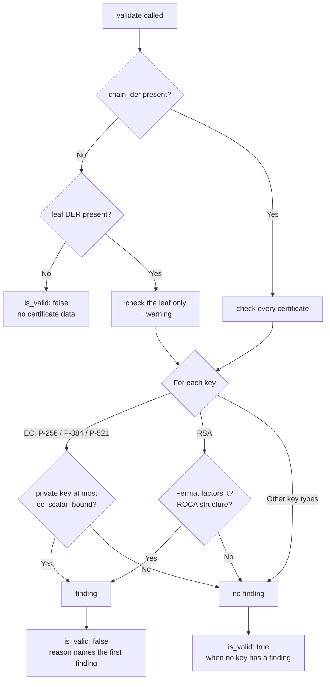

# WeakKeys Validator

The `weak_keys` validator answers one question: **can anyone recover the private key from the public one?**

That sounds like it should never happen, and for a properly generated key it doesn't. But keys are made by software, and software has bugs. When a key generator gets it wrong in certain ways, the mistake leaves a fingerprint in the public key that anyone can spot, and from there the private key falls out.

This isn't hypothetical. In October 2026, eight eMudhra intermediate CA certificates turned out to have P-384 private keys that were tiny integers. One of them was literally the number 4. Anyone holding one of those keys could sign a certificate for any website, and browsers trusted it.

!!! info "On by default"
    `weak_keys` is one of the four default validators, along with `expiration`, `hostname`, and `root_certificate`. You don't have to turn it on.

## Why check the whole chain?

`key_info` already looks at your key, so why another validator?

Because `key_info` asks a different question. It checks that your key is a *strong type*: a 2048-bit RSA modulus, an approved curve. The eMudhra keys passed that check easily, since P-384 is a perfectly good curve.

And `key_info` only looks at the leaf. In the eMudhra incident, every leaf key was fine. The weak keys belonged to the **intermediates**, the CA certificates your server sends along with its own. A weak CA key is worse than a weak leaf key, because it compromises every certificate the CA ever signed, not just yours.

So `weak_keys` checks the leaf **and every certificate in the chain**.

## What it looks for

Three weaknesses, each one a pattern that's cheap to spot and that real key generators have produced:

| Check | What it means | Seen in the wild |
|---|---|---|
| `ec_small_scalar` | An EC private key (P-256, P-384, P-521) that is a small number, found by counting up from the public key. | The eMudhra intermediates, 2026 (private keys from 4 to 237). |
| `rsa_close_primes` | RSA primes so close together that Fermat's method factors the modulus in a few steps. | CVE-2022-26320 (printers and other devices using one vendor's library). |
| `rsa_roca` | The structure of keys from Infineon's RSALib, which can be factored. | CVE-2017-15361 (ROCA: smart cards, TPMs, ID cards). |

!!! warning "Passing doesn't prove a key is good"
    `weak_keys` spots known patterns. It can't measure how random a key really is, so a pass means "none of these weaknesses is present", not "this key was generated well". Key types without a check, such as Ed25519 or post-quantum keys, always pass.

## Try it

Let's say you want to see what the eMudhra chain looks like. Download `chains.zip` from the [incident site](https://emudhra.we-have-a-problem.com/), take `dv-g3b-emudhra.we-have-a-problem.com.pem` out of it, and run:

```console
$ certmonitor check --file dv-g3b-emudhra.pem --validators weak_keys
dv-g3b-emudhra.pem  sha256:9dcb21b1841d75313b3c888f4bb9cc01f8f51379a76fbaa241ca492b668839e7
  FAIL   weak_keys          The certificate at position 1 (EM DV TLS CA - G3B (eMudhra BV)) has a private key anyone can recover from its public key (ec_small_scalar).
```

Notice **position 1**. Position 0 is the leaf, and it passed. The problem is the intermediate right above it.

The same thing from Python:

```python
from certmonitor import CertMonitor

with CertMonitor.from_file("dv-g3b-emudhra.pem") as monitor:
    result = monitor.validate()["weak_keys"]

for finding in result["findings"]:
    print(finding["position"], finding["role"], finding["subject"]["commonName"], finding["check"])
```

```text
1 intermediate EM DV TLS CA - G3B ec_small_scalar
```

A live scan works the same way: `CertMonitor("example.com")` checks every certificate the server sends.

## Seeing the recovered key

By default, a finding tells you the key *can* be recovered and which check proved it, but it doesn't print the key. A recovered key is a working private key, and results end up in logs, dashboards, and alert emails. You don't want a CA's signing key sitting in your Slack channel, even a revoked one.

When you do need the proof, ask for it with `show_evidence`:

```console
$ certmonitor check --file dv-g3b-emudhra.pem --validators weak_keys \
    --arg weak_keys.show_evidence=true --json
```

```json
{
  "position": 1,
  "role": "intermediate",
  "subject": {
    "commonName": "EM DV TLS CA - G3B",
    "organizationName": "eMudhra BV",
    "countryName": "NL"
  },
  "check": "ec_small_scalar",
  "detail": "The EC private key is a small integer, so anyone can find it by counting from the public key.",
  "evidence": {
    "private_scalar": 156
  }
}
```

That's the eMudhra DV G3B intermediate's private key: 156. From Python, pass `validator_args={"weak_keys": {"show_evidence": True}}`.

For `rsa_close_primes` the evidence is the two primes, `p` and `q`. A `rsa_roca` finding never has evidence, because actually factoring a ROCA key takes far more work than spotting one.

!!! tip "Going straight to the source"
    The EC search is also available on its own as `certinfo.ec_small_scalar(spki_der, bound)`, which takes a DER SubjectPublicKeyInfo and returns the private key as an `int`, or `None`.

## How far does it count?

For `ec_small_scalar`, the validator looks for a private key up to `ec_scalar_bound`, which defaults to **4096**. That's sixteen times further than the largest eMudhra key, 237.

The first 4096 candidates are the same for every key, so CertMonitor ships them as a small precomputed table. Checking a key against all of them is a single lookup that takes microseconds, which is why `weak_keys` can run on every scan without slowing it down.

You can go further, up to 2**24, if you're auditing something specific. Past the table, each extra candidate costs one point addition, about 8 microseconds on P-384, so 65536 adds roughly half a second per EC key:

```python
with CertMonitor(
    "example.com",
    validator_args={"weak_keys": {"ec_scalar_bound": 65536}},
) as monitor:
    print(monitor.validate()["weak_keys"]["is_valid"])
```

!!! info "Scanning lots of hosts?"
    The same intermediates show up behind thousands of sites. `weak_keys` remembers each key it has already checked, so a `scan_hosts()` run pays for each distinct intermediate once. That matters most for RSA keys, whose checks take a millisecond or two each, and for a raised `ec_scalar_bound`.

## How it decides



## Reference

::: certmonitor.validators.weak_keys.WeakKeysValidator
